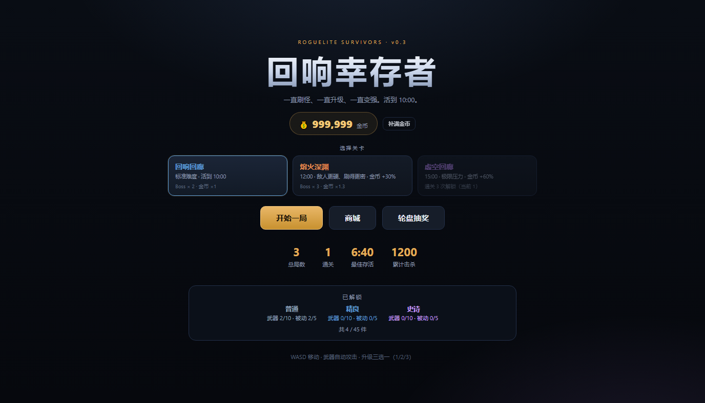
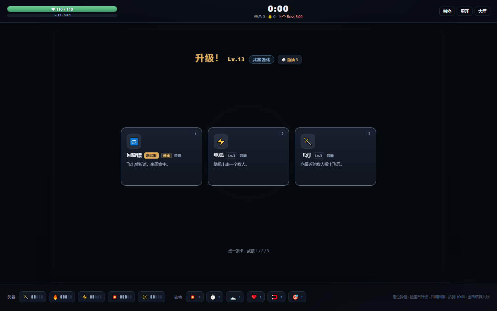
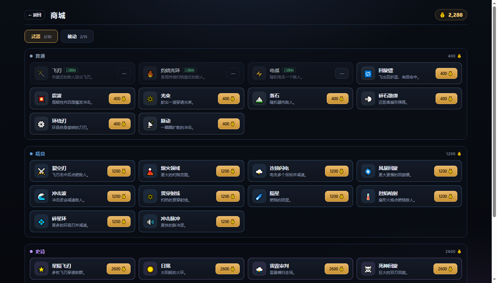
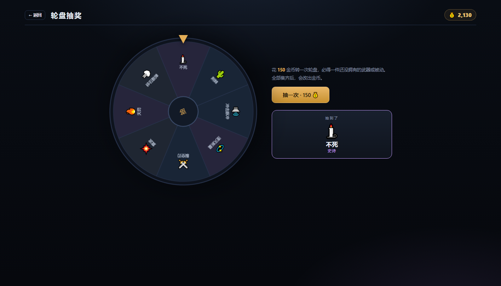

# 回响幸存者 Echo Survivors — v0.3

> 📄 配套需求文档：[《回响幸存者》游戏需求文档 v1.0](docs/回响幸存者_游戏需求文档_v1.0.docx)（31 页，与当前 v0.3 代码同步）· [PDF 版](docs/回响幸存者_游戏需求文档_v1.0.pdf)



「一直刷怪、一直升级、一直变强」的幸存者类游戏 + 局外收集/经济系统。

- **局内**：走位躲怪 → 武器自动攻击 → 吃经验宝石升级 → 三选一强化（新武器 / 武器升级 / 被动）
- **局外**：打一局赚金币 → 商城买武器/被动，或用金币转轮盘抽奖 → 解锁更多内容，下一局更强

## 快速开始

- **直接玩**：双击 `dist/echo-survivors.html`（或 `play.bat`），浏览器打开即玩，存档自动保存在本地
- **从源码跑**：`pnpm install` → `pnpm dev`
- **重新构建**：`pnpm build`（类型检查 + Vite 构建 + 打包单文件 HTML）

## 怎么玩

**双击 `dist/echo-survivors.html`**（或 `play.bat`），浏览器打开即可，存档自动保存在本地。

| 操作 | 方式 |
|---|---|
| 移动 | `WASD` / 方向键 |
| 攻击 | 自动 |
| 升级选择 | 点卡片 / `1` `2` `3` |
| 暂停 | 空格 / Esc |
| 重开 | 结算界面按 `R` |
| 返回大厅 | 右上角「大厅」 |

## 局内成长（v0.3 新增）

- **武器 5 格 / 被动 6 格**：满了之后，新的武器/被动仍会出现，标注「替换」——点开选择换掉哪一件，新装备从 Lv.1 开始
- **奇偶等级规则**：**奇数等级只出武器，偶数等级只出被动**（不会再出现「被动一个都不给」）。升级界面右上角会显示本层是「武器强化」还是「被动强化」；某一类实在没得选时自动退回另一类
- **选项组合规则**：槽位满了之后，三选一里**最多 1 张「替换」**，其余优先给已有武器/被动的升级（等级越低越容易刷到）；只有升级池刷空（全满级）时才会出现多张替换
- **重抽**：每次升级可以花 1 次「重抽」换掉三张牌（每局 3 次），解决「三张全是垃圾」
- **稀有度倾斜**：关卡越深，稀有/史诗出现权重越高；三选一保底至少一张非普通（只要池里有）
- **关卡**：

| 关卡 | 时长 | 敌人强度 | 刷怪 | 金币 | Boss | 解锁条件 |
|---|---|---|---|---|---|---|
| 回响回廊 | 10:00 | ×1.0 | ×1.0 | ×1.0 | 2 只 | 初始 |
| 熔火深渊 | 12:00 | ×1.28 | ×0.9（更密） | ×1.3 | 3 只 | 通关 1 次 |
| 虚空回廊 | 15:00 | ×1.55 | ×0.82 | ×1.6 | 4 只 | 通关 3 次 |

通关奖励随关卡提高：200 / 350 / 500 金币。

## 截图

| 大厅 | 升级三选一（武器层） |
|---|---|
|  |  |

| 商城 | 轮盘抽奖 |
|---|---|
|  |  |

## 内容量（3 个稀有度）

| 稀有度 | 武器 | 被动 | 商城价格 |
|---|---|---|---|
| 普通 | 10 把 | 5 个 | 武器 400 / 被动 260 |
| 精良 | 10 把 | 5 个 | 武器 1200 / 被动 780 |
| 史诗 | 10 把 | 5 个 | 武器 2600 / 被动 1600 |

**共 30 把武器 + 15 个被动 = 45 件**。每把武器局内可升到 5 级。

武器按机制分 10 类（每类 3 个稀有度）：飞刃 / 光环 / 闪电链 / 回旋镖 / 新星 / 光束 / 陨星 / 散弹 / 环绕刃 / 脉冲。
元素效果：**灼烧**（持续掉血）与 **减速**。

被动：锋锐、急速、疾行、体魄、磁铁、锐眼（暴击）、吸血、荆棘、幸运、铁壁、屠戮、疾风、巨躯、贪婪、不死（复活一次）。

## 局外系统

- **金币**：击杀敌人 / 拾取 / 存活 / 通关都会产出，结算时入账（通关额外 +200）
- **商城**：按稀有度定价，直接买断指定武器/被动，买到的会进入局内「升级三选一」的池子
- **轮盘抽奖**：150 金币一次，8 格轮盘转出必得一件未拥有的武器/被动（按稀有度权重）；全部集齐后改为出金币
- **本地存档**：`localStorage` 键 `echo-survivors-save-v1`，保存金币、已解锁内容、总局数/通关数/最佳存活/累计击杀

初始状态：1200 金币、2 把普通武器（飞刃/灼烧光环）+ 2 个普通被动（锋锐/疾行）。

## 开发

```bash
pnpm install
pnpm dev          # http://127.0.0.1:5200
pnpm build        # 类型检查 + 构建 + 打包单文件 HTML
pnpm sim          # 引擎模拟：全部内容解锁，跑 3 局
node scripts/run-sim.mjs starter 3   # 模拟新手初始配置
node scripts/verify-meta.mjs         # 验收：结算/商城/抽奖/存档（需先开调试端口 9225）
# 引擎自检：槽满替换 / 重抽 / 关卡参数（esbuild 打包后 node 跑）
node_modules/.pnpm/@esbuild+win32-x64@0.21.5/node_modules/@esbuild/win32-x64/esbuild.exe   scripts/check.ts --bundle --format=esm --platform=node --outfile=.tmp/check.mjs && node .tmp/check.mjs
```

**开发参数（改金币）**：在地址后面加 `?coins=999999`，打开时会把存档金币直接设为该数值并持久化。
刷新页面会再次生效，所以想「重新发钱」时只要刷新一次即可。

## 目录结构

```
src/
  game/
    types.ts     类型
    config.ts    世界/难度/敌人/玩家
    content.ts   ★ 30 武器 + 15 被动 + 稀有度定价
    engine.ts    模拟核心（10 种武器机制、状态、经验、金币、抽奖）
  meta/save.ts   localStorage 存档
  render/draw.ts Canvas 渲染
  ui/
    MenuScreen.tsx   大厅（金币/统计/解锁进度）
    ShopScreen.tsx   商城
    GachaScreen.tsx  轮盘抽奖
    GameCanvas.tsx   游戏循环与输入
    hud.ts           HUD 快照
  App.tsx        路由 / 结算入账 / 升级三选一
```

## 平衡数据（引擎模拟，10 分钟一局）

| 配置 | 结果 | 等级 | 击杀 | 本局金币 |
|---|---|---|---|---|
| 全解锁（45 件） | 通关 ×3 | Lv.56–62 | ~6000 | 1100–1800 |
| 新手初始（4 件） | 死亡 ×2（约 7:05） | Lv.37–39 | ~2500 | 380–420 |

设计意图：**新手需要靠局外成长才能打通**——这也是收集/商城/抽奖的意义。

## 验收记录（自动化）

用 CDP 真点了一遍局外流程：

1. 结算入账：初始 1200 + 局内 1280 + 通关 200 = **2680** ✓
2. 商城购买 400 金币武器：2680 → **2280**，出现「已拥有」标记 ✓
3. 轮盘抽奖：2280 → **2130**（150 一次），抽到「不死（史诗）」 ✓
4. 存档写入：`{coins: 2130, weapons: 3, passives: 3, runs: 1, wins: 1}` ✓
5. 控制台错误：0

## 下一步

- [ ] 武器进化：两把满级武器合成终极武器
- [ ] 关卡专属机制（熔火出火怪、虚空有减速立场）
- [ ] 局内「本局目标」（如 10 分钟内击杀 1000 额外奖励）
- [ ] 图鉴页（查看全部内容与说明）
- [ ] 每日商店刷新 / 限时折扣
- [ ] 角色与初始武器选择
- [ ] 音效与受击顿帧
- [ ] 局外永久加成（谨慎：不要破坏单局平衡）

## 已知取舍

- 单张地图（2400×1600）
- 无音效
- 存档只存一件（没有多档位、没有云同步）
